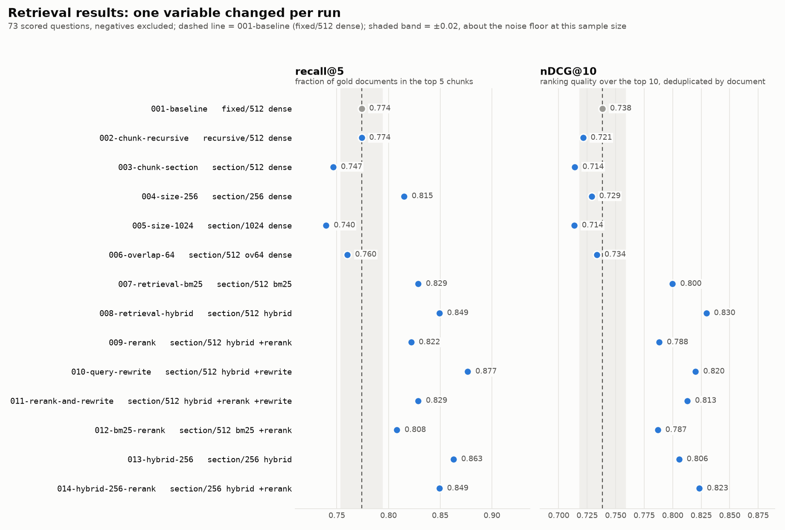

# clinical rag-evals

[](https://github.com/cstebs/clinical-rag-evals/actions/workflows/ci.yml)  [](LICENSE)

Retrieval-augmented question answering over FDA guidance documents, where the
evaluation harness is the product and the retrieval pipeline is the thing being
measured.

Everyone has a RAG demo. Very few can answer *"how do you know it works?"* with
numbers. This repo is the answer to that question: a published table showing what
was changed, what it bought, and how that was measured, including the part almost
nobody does: checking whether the LLM judge doing the measuring can be
trusted at all.

There is deliberately no chatbot UI. A frontend would add nothing to the argument.

---

## TL;DR

Fourteen retrieval configurations over 124 FDA guidance documents, 85 hand-authored
questions, one variable changed per run. What the table says:

- **Hybrid retrieval (BM25 + dense, rank-fused) beat dense-only by +0.103 recall@5
  and +0.115 nDCG@10.** BM25 alone also beat dense. Regulatory prose is dense with
  exact terms of art, and a web-trained embedding model does not know them.
- **Cross-encoder reranking made things worse at 512-token chunks (-0.041 nDCG@10),
  and the harness says why:** the reranker reads a 512-token window and 60% of the
  passages it scored ran over it. At 256-token chunks the sign flips (+0.018).
- **Chunking strategy bought nothing.** Section-aware chunking, by far the most work
  to build, is no better than blind fixed windows. Chunk size is the knob that
  matters: 256 tokens is +0.069 recall@5.
- **LLM query rewriting gives the best deep recall** (recall@10 0.952, the best in
  the table) and the worst first hit (recall@1 drops 0.09). Same mechanism, two sides.
- **The LLM judge is validated, not assumed:** Cohen's κ = 0.81 on correctness and
  1.00 on abstention against 40 blind hand labels, with every disagreement published
  beside the judge's reasoning.
- **Generation fails by refusing, not by inventing:** zero confabulations on 12 trap
  questions, including one that names a real document and asks for a figure it does
  not contain. The cost is 11 false abstentions, concentrated in multi-hop questions.
- **An earlier version of this table was measuring a bug** in the heading detector.
  Every affected run was re-run and three findings changed size or sign. That is
  written up below rather than quietly replaced.

The retrieval half reproduces for $0 with no credentials. The generation half cost
about $5 in total API spend, and every run record carries its own cost accounting.



*Generated from the committed run records by `rag-evals plot`, so it cannot drift from the table below.*

**What the harness fed.** The configuration this table selected, `008-retrieval-hybrid`,
ships as the retriever behind [clinical-guidance-mcp](https://github.com/cstebs/clinical-guidance-mcp),
an MCP server that exposes search over the same FDA corpus to Claude and other MCP
clients. That repo imports this one and pins run 008's settings, so the retrieval
numbers above are the numbers for what it actually serves. The eval chose the
config; the server ships it.

**The same lesson, from classical ML.** [fda-guidance-ml](https://github.com/cstebs/fda-guidance-ml)
runs classification, regression and clustering on the titles of the full FDA guidance
index this corpus was drawn from (2,787 documents). There too, exact-term features beat
dense embeddings: TF-IDF with logistic regression predicts the issuing center at 0.852
macro-F1, and sentence embeddings and a PyTorch MLP do not beat it. Regulatory text is
carried by its terms of art, whether you are retrieving passages or classifying titles.

---

## What's actually here

| | |
|---|---|
| **Corpus** | FDA guidance documents for industry (CDER + CBER), fetched from FDA's public index, checksummed, and pinned in a committed manifest |
| **Gold set** | 85 hand-authored questions in four categories, every quote verified verbatim against the parsed corpus |
| **Retrieval metrics** | recall@{1,3,5,10}, MRR, nDCG@10. Deterministic, model-free, free to run |
| **Generation metrics** | groundedness, answer correctness, abstention accuracy, scored by an LLM judge |
| **Judge validation** | Cohen's κ between the judge and hand labels, with the disagreements published |
| **Experiment matrix** | 14 configs across chunking, chunk size, overlap, retriever, reranking and query rewriting |
| **Discipline** | one variable per run, enforced in code. A run that moves two variables warns before it executes |

---

## Quickstart

```bash
git clone https://github.com/cstebs/clinical-rag-evals.git && cd clinical-rag-evals
python -m venv .venv && .venv/bin/pip install -e ".[dev]"   # Windows: .venv\Scripts\pip

rag-evals ingest              # fetch + parse the corpus (see the note on crawl time)
rag-evals validate-gold       # every gold quote must be found verbatim in the corpus
rag-evals sweep --no-generate # the entire retrieval matrix, $0, no credentials
rag-evals report              # results table + deltas + failure analysis
```

`--no-generate` runs everything that does not require a model. To add generation
and judging, set `ANTHROPIC_API_KEY` (or run `ant auth login`) and drop the flag.
If the key is identity-linked, also set `ANTHROPIC_WORKSPACE_ID`; the client
sends it as the `anthropic-workspace-id` header the API requires for such keys.
To exercise the generation and judging *code paths* with no credentials at all,
use `--stub-llm`; runs made that way are stamped `stub_llm: true` and refuse to
be used for judge validation.

> **Crawl time.** `https://www.fda.gov/robots.txt` declares `Crawl-Delay: 30` for
> `User-agent: *`. The ingester reads that file at runtime, honours the declared
> delay, and refuses any path robots.txt disallows. A full ingest therefore takes
> a bit over an hour. `--delay` can only slow it down, never speed it past what
> FDA asks for. Use `--limit 20` for a quick look.

---

## The corpus

FDA publishes its complete guidance index as a public JSON file backing the
"Search for FDA Guidance Documents" DataTable. We read that index, 2,788 rows,
and select from it rather than crawling the site.

**Selection** (narrow and deep beats broad and shallow):

- issuing center is CDER or CBER (drugs and biologics),
- communication type is "Guidance Document",
- status is Final,
- and the title or topics match a clinical-research keyword set.

That yields **127 documents**: 2,980 pages, 7.0 million characters, 39 MB of
PDFs. ICH guidelines (E3, E9, E10, E11, E2E, M3(R2)), the SUPAC series,
bioavailability and bioequivalence guidance, pharmacovigilance, oncology
endpoints, IND content and phase 1 CGMP. 109 are CDER, 15 CBER.

**Why FDA guidance and not something tidier.** ClinicalTrials.gov is too
structured. Retrieval quality barely varies on it, so the eval would show flat
results and prove nothing. ICH GCP alone is too small. FDA guidance is long,
inconsistently structured, PDF-heavy, and full of tables, footnotes and
cross-references. Retrieval strategies genuinely differ on it, which is what
makes the table worth reading.

**What is committed.** `data/manifest.json` only: URLs, SHA-256 checksums, byte
sizes, fetch dates, and per-document parse statistics. The PDFs and extracted
text are gitignored. A clone reproduces the exact corpus by re-running `ingest`
and comparing checksums, without redistributing FDA's documents.

**Parse quality is measured, not assumed.** Extraction runs through PyMuPDF and
records characters per page. Documents below 200 chars/page are almost certainly
image-only scans, are flagged in the manifest, and are excluded from the index.
Three of the 127 selected documents (2.4%) turned out to be scans yielding
**exactly zero** extractable characters, and all three are pre-2000 guidances. This
matters more than it sounds:
a document whose text never extracted cannot be retrieved by *any* strategy, so
leaving it in would depress every row of the table by the same amount and hide
the real differences between configurations.

---

## The eval design

### Gold question set: 85 questions, four types

Stored as versioned JSONL in `evals/gold.jsonl`, generated by
`scripts/build_gold.py`, which is kept in the repo as the record of how the set
was built.

| Type | n | What it tests |
|---|---|---|
| `fact` | 45 | One passage, one unambiguous answer. Baseline sanity. |
| `multi_hop` | 14 | The answer requires combining two or more documents. |
| `near_miss` | 14 | A plausible-but-wrong passage scores highly on similarity. |
| `negative` | 12 | The corpus genuinely cannot answer it. The system must decline. |

**How they were authored.** Not by inventing questions and hoping the corpus
answers them. `scripts/candidate_passages.py` surfaces concrete, checkable
statements from the real parsed text: passages 80 to 320 characters long, not front
matter, carrying a regulatory signal (a modal like "should" or "must", a
definition, or a quantity). Each question was then written to be answered by a
specific passage. That ordering makes every answerable item answerable *by
construction*.

`rag-evals validate-gold` then re-reads the parsed corpus and checks every
`source_quote` verbatim (after normalising ligatures, curly quotes and line-wrap
whitespace, which PDF extraction mangles but meaning does not). This catches
three bug classes at once that all look healthy from the outside: a mislabelled
document id, a quote that was paraphrased rather than copied, and a document
whose parse silently produced garbage. It currently reports **0 errors, 0
warnings**, and it caught a real bad quote during authoring, a dropped "also".

**The negative cases are the interesting ones**, and they come in two flavours:

- *Off-domain.* Device, tobacco, veterinary and food questions. The corpus is
  CDER and CBER only, so these have no answer in it anywhere.
- *On-domain but unanswerable.* Questions phrased in the exact vocabulary of the
  corpus, asking for a threshold no guidance actually states. *"What is the
  maximum number of protocol deviations FDA permits before a clinical trial is
  considered invalid?"* Retrieval will return confident, highly similar passages
  from ICH E9 and E3, and the system must still decline. The hardest one names a
  document that **is** in the corpus and asks for a figure that document does not
  contain, so retrieval succeeds completely and the model still has to say no.

### Relevance is graded at document granularity, on purpose

This is the single most important decision in the harness.

If gold labels were pinned to character offsets in a specific passage, then
changing the chunking strategy would change which spans exist, and therefore
change what "correct" means. Every row of a chunking sweep would be scored
against a subtly different rubric, and the deltas, the entire product, would be
meaningless. Grading on document ids keeps the target fixed while the pipeline
underneath it varies.

The verbatim `source_quotes` are still stored. They prove a question is
answerable, they give the judge and the human labeller something concrete to
check, and they are never used for retrieval scoring.

### recall@k is a chunk budget

`recall@k` here means: take the top *k chunks*, collapse them to the set of
distinct documents they came from, and ask what fraction of the gold documents
that set covers. k counts chunks because chunks are what actually occupy the
generator's context window. Reporting recall over the top-k *documents* instead
would flatter every configuration by silently granting a deeper read.

MRR and nDCG@10 are computed over the deduplicated document ranking, with binary
relevance. Binary because the gold set records "this document contains the
answer" and nothing finer. Inventing graded relevance would mean inventing
labels.

Negative cases are **excluded** from retrieval scoring rather than scored zero.
Scoring them zero would punish a system for correctly having nothing to find;
scoring them one would inflate every number. They are graded on abstention
instead.

### Abstention accuracy is measured over every question, not just the negatives

A system that abstains on everything gets 100% on the negative cases. So
abstention accuracy is (correct abstentions + correct answering attempts) over
*all* questions: the false abstentions on answerable questions drag the same
number down. `false_abstentions` and `confabulations` are both reported raw in
every run record.

### The LLM judge

Judge model: `claude-opus-5` via the official `anthropic` SDK, with adaptive
thinking (`thinking={"type": "adaptive"}`) and `effort: high`, because grading is the
measurement instrument, and a sloppy instrument invalidates the table.

Three design decisions worth stating:

1. **One call scores all three metrics.** Groundedness, correctness and
   abstention depend on the same evidence. Splitting them into three calls
   triples the bill and yields three inconsistent readings of one situation.

2. **The judge sees the reference answer for correctness and is told to ignore it
   for groundedness.** These are genuinely different questions. An answer can be
   correct in substance while citing nothing that supports it: a confabulation
   that happened to land right, which is the most dangerous failure mode in a
   regulated domain and the one a naive "did it match?" metric scores as a win.

3. **Raw judge reasoning is stored for every item**, not just the score. The
   failure analysis below is only writable because you can read *why*, and
   judge validation is only actionable because you can see where the judge and a
   human diverged.

### Validating the judge, the part that makes this worth reading

An unvalidated LLM judge is vibes with extra steps.

```bash
rag-evals run configs/008-retrieval-hybrid.yaml   # produces answers + judge verdicts
# hand-label 30-50 items into evals/human_labels.jsonl (rag-evals label)
rag-evals validate-judge --run-id 008-retrieval-hybrid
```

This reports, per field, raw agreement and **Cohen's κ**, plus every disagreement
with the judge's reasoning next to the human note.

κ rather than raw agreement, because raw agreement is misleading on a skewed
label set: if 90% of answers are grounded, a judge that says "grounded"
unconditionally scores 90% agreement while carrying zero information. κ subtracts
the agreement expected from the marginals, so that degenerate judge scores 0.
(There is a test asserting exactly that.) Read as: <0.4 poor, 0.4–0.6 moderate,
0.6–0.8 substantial, >0.8 near-ceiling.

Human labels are pinned to a `run_id`, because a label is only meaningful against
the answer text it was written for. Reusing old labels against new answers would
produce an agreement number that means nothing. The file is hand-edited, so the
loader lints it on read and reports the line number of a malformed entry rather
than a JSON traceback; a dropped closing quote on `note` is the typo it exists for.

#### Result: 40 labels against `008-retrieval-hybrid`

Forty items were hand-labelled from run 008 (17 fact, 12 negative, 6 multi-hop,
5 near-miss), blind to the judge's verdicts, following the procedure in the
header of `evals/human_labels.jsonl`.

| Field | n | Raw agreement | Cohen's κ | Judge harsh | Judge lenient |
|---|---|---|---|---|---|
| grounded | 40 | 100% | 1.00 | 0 | 0 |
| correct | 28 | 92.9% | **0.81** | 2 | 0 |
| abstained | 40 | 100% | 1.00 | 0 | 0 |

Correctness is scored on 28 items because it is undefined for the 12 negative
questions, which have no reference answer.

Three things to read out of that table, in decreasing order of comfort:

1. **Abstention detection is solved.** 14 of 40 labelled items were abstentions
   and the judge caught every one with no false positives. This is the field the
   abstention-accuracy metric above depends on, so that number can be read as-is.

2. **The grounded κ of 1.00 is a degenerate value, not evidence.** All 40
   labelled answers were grounded, by both raters, so the marginals leave the
   chance-corrected term with nothing to correct. The 100% agreement says the
   judge never hallucinated an unsupported claim where a human saw none; it says
   nothing about whether it would catch one. Run 008's answers simply did not
   produce an ungrounded item in the sample, which is itself a result, but a
   different one.

3. **Correctness κ = 0.81 is the number that carries information, and both
   disagreements are the same disagreement.** The judge was harsh on q051
   (ICH E9 / E3 on excluded subjects) and q057 (ICH E3 / FDA format guidance on
   uncontrolled studies). In both, the system answered from the right documents
   with grounded, on-topic content, but from *different passages* than the ones
   the reference answer was authored against. The judge, instructed to grade
   against the reference, ruled the specific reference points absent. The human
   read the answers as substantively correct responses to the question as asked.
   Both are multi-hop questions, which fits the failure analysis below: multi-hop
   is where a grounded answer built from one passage per document is most likely
   to miss the exact sentence the gold author had in mind.

The consequence for the results table: the multi-hop correctness figures are the
ones most exposed to this. The judge is not miscalibrated so much as the
reference answers are more specific than the questions, and a strict
reference-matching judge inherits that specificity. A looser correctness rubric
would move κ toward 1.0 and the multi-hop correctness score upward, at the cost
of letting through answers that skip the clause a reviewer actually wanted.
This project keeps the strict reading and publishes the disagreement instead.

Full output, including the judge's reasoning beside each human note, is in
`results/judge-validation-008-retrieval-hybrid.json`.

---

### Prompt versioning, change control, and rollback

The judge prompt is the measurement instrument, and the generator prompt is
the thing being measured, so neither lives inline in the source. Every system
prompt is a versioned file under `prompts/<name>/<version>.md` with front
matter (status, owner, purpose, what changed and why), every run config pins an
explicit version of each, and every run record stores the version **and the
SHA-256 of the text** it ran with:

```json
"prompts": {
  "generate": {"version": "v1", "sha256": "704fc3dd...", "path": "prompts/generate/v1.md"},
  "judge":    {"version": "v1", "sha256": "a3989c07...", "path": "prompts/judge/v1.md"},
  "rewrite":  {"version": "v1", "sha256": "31aa3576...", "path": "prompts/rewrite/v1.md"}
}
```

Since 0.3.0 each record also carries a `code` block: the harness's own git
commit SHA at run time, whether the tree was dirty, and the package version.
The prompt hashes pin the instrument; this pins the code that held it.

Three rules follow, each enforced by code rather than by convention:

1. **A published version is immutable.** `rag-evals prompts audit` compares the
   hash in every committed run record against the file on disk and exits
   non-zero on a mismatch, and `tests/test_prompts.py` pins the hash of every
   non-draft version. To change a prompt you add `v(N+1)`; editing `vN` fails
   the suite.
2. **A prompt bump is one experimental variable.** The `prompts:` section is
   part of `RunConfig`, so the isolation rule treats a judge-prompt change
   exactly like a chunking change. A run that bumps the judge and the generator
   together gets the same warning as any other two-variable run.
3. **Rollback is a config edit, and it is free.** The LLM cache key already
   includes the full system prompt text, so re-running a config pinned back to
   a version that has results makes zero API calls and reproduces the earlier
   row exactly.

```bash
rag-evals prompts list                 # versions, status, hash, and which runs used each
rag-evals prompts diff judge v1 v2     # what would change, before deciding
rag-evals prompts audit                # every record, file and config agree, or exit 1
```

The full procedure for shipping a prompt change (draft, single-variable
config, re-validate the judge if it is the judge, promote or retire, changelog)
and for rolling one back is in [`prompts/README.md`](prompts/README.md). Changes
to any prompt are logged under a **Prompts** heading in
[`CHANGELOG.md`](CHANGELOG.md).

---

## The experiment matrix

Each config in `configs/` is one run and one row. The point is the deltas.

| Dimension | Variants |
|---|---|
| Chunking | fixed-size, recursive, section-aware (headings detected from PDF typography) |
| Chunk size | 256 / 512 / 1024 tokens, with and without overlap |
| Retrieval | BM25 (lexical), dense (embeddings), hybrid (reciprocal rank fusion) |
| Reranking | none vs. a cross-encoder over a deeper candidate pool |
| Query handling | raw query vs. LLM query rewriting and expansion |

Run `001-baseline` is deliberately weak (fixed 512-token windows over flat text,
dense-only, no reranking) so there is visible headroom. A baseline that is
already good makes for a boring table.

**One variable per run, enforced in code.** Every config declares the `baseline`
it is a delta against. `RunConfig.diff` computes what moved, and a run that moves
more than one meaningful variable prints a warning before it executes. There is a
test asserting that every config shipped in this repo obeys its own rule. Run
`011` is the deliberate exception, labelled as such: it stacks two changes to ask
whether their gains overlap.

---

## Results

### Corpus

- **Documents selected:** 127 (from 2,788 in the FDA index)
- **Usable after parsing:** 124 (3 excluded for low text yield)
- **Pages:** 2,980  **Characters:** 7,000,483
- **Issuing centers:** Center for Drug Evaluation and Research (109), Center for Biologics Evaluation and Research (15)
- **Index fetched:** 2026-08-28


### Retrieval results

| Run | Configuration | R@1 | R@5 | R@10 | MRR | nDCG@10 | Grounded | Correct | Abstain |
|---|---|---|---|---|---|---|---|---|---|
| `001-baseline` | fixed/512 dense | 0.562 | 0.774 | 0.856 | 0.716 | 0.738 | - | - | - |
| `002-chunk-recursive` | recursive/512 dense | 0.555 | 0.774 | 0.836 | 0.709 | 0.721 | - | - | - |
| `003-chunk-section` | section/512 dense | 0.534 | 0.747 | 0.843 | 0.695 | 0.714 | - | - | - |
| `004-size-256` | section/256 dense | 0.527 | 0.815 | 0.863 | 0.709 | 0.729 | - | - | - |
| `005-size-1024` | section/1024 dense | 0.527 | 0.740 | 0.856 | 0.684 | 0.714 | - | - | - |
| `006-overlap-64` | section/512 ov64 dense | 0.555 | 0.760 | 0.863 | 0.718 | 0.734 | - | - | - |
| `007-retrieval-bm25` | section/512 bm25 | 0.671 | 0.829 | 0.890 | 0.786 | 0.800 | - | - | - |
| `008-retrieval-hybrid` | section/512 hybrid | 0.699 | 0.849 | 0.918 | 0.821 | 0.830 | 0.968 | 0.712 | 0.871 |
| `009-rerank` | section/512 hybrid +rerank | 0.623 | 0.822 | 0.884 | 0.793 | 0.788 | - | - | - |
| `010-query-rewrite` | section/512 hybrid +rewrite | 0.610 | 0.877 | 0.952 | 0.793 | 0.820 | - | - | - |
| `011-rerank-and-rewrite` | section/512 hybrid +rerank +rewrite | 0.637 | 0.829 | 0.925 | 0.809 | 0.813 | - | - | - |
| `012-bm25-rerank` | section/512 bm25 +rerank | 0.623 | 0.808 | 0.897 | 0.785 | 0.787 | - | - | - |
| `013-hybrid-256` | section/256 hybrid | 0.685 | 0.863 | 0.877 | 0.808 | 0.806 | - | - | - |
| `014-hybrid-256-rerank` | section/256 hybrid +rerank | 0.699 | 0.849 | 0.897 | 0.831 | 0.823 | - | - | - |


### What each change bought

| Run | Changed from baseline | d R@5 | d MRR | d nDCG@10 |
|---|---|---|---|---|
| `002-chunk-recursive` | `strategy`: fixed -> recursive | +0.000 | -0.006 | -0.017 |
| `003-chunk-section` | `strategy`: recursive -> section | -0.027 | -0.015 | -0.007 |
| `004-size-256` | `target_tokens`: 512 -> 256 | +0.069 | +0.014 | +0.015 |
| `005-size-1024` | `target_tokens`: 512 -> 1024 | -0.007 | -0.011 | -0.000 |
| `006-overlap-64` | `overlap_tokens`: 0 -> 64 | +0.014 | +0.024 | +0.019 |
| `007-retrieval-bm25` | `index`: dense -> bm25 | +0.082 | +0.092 | +0.086 |
| `008-retrieval-hybrid` | `index`: dense -> hybrid | +0.103 | +0.127 | +0.115 |
| `009-rerank` | `rerank`: False -> True | -0.027 | -0.029 | -0.041 |
| `010-query-rewrite` | `query_rewrite`: False -> True | +0.027 | -0.029 | -0.009 |
| `011-rerank-and-rewrite` | `query_rewrite`: False -> True | +0.007 | +0.016 | +0.025 |
| `012-bm25-rerank` | `rerank`: False -> True | -0.021 | -0.001 | -0.013 |
| `013-hybrid-256` | `target_tokens`: 512 -> 256 | +0.014 | -0.013 | -0.024 |
| `014-hybrid-256-rerank` | `rerank`: False -> True | -0.014 | +0.022 | +0.018 |


### Failure analysis

#### `008-retrieval-hybrid`: failures by question type

| Type | n | Retrieval hit@5 | Grounded | Correct | Abstained |
|---|---|---|---|---|---|
| fact | 45 | 0.96 | 1.00 | 0.87 | 0.07 |
| multi_hop | 14 | 1.00 | 0.93 | 0.14 | 0.43 |
| near_miss | 14 | 1.00 | 0.93 | 0.79 | 0.14 |
| negative | 12 | - | 1.00 | 1.00 | 1.00 |

**2 questions retrieved nothing relevant in the top 5.**

- `q018` (fact): How does ICH E11 say the need for juvenile animal studies should be decided?
  - expected: fda-71355
  - got: fda-82725, fda-71542, fda-101398
- `q033` (fact): Under ICH E10, what limits does FDA place on the use of external controls?
  - expected: fda-71349
  - got: fda-157560, fda-116850, fda-97567


### What the table actually says

**Read the noise floor first.** 73 of the 85 questions are scored for retrieval
(the 12 negatives are excluded by design). At that sample size a difference of
roughly 0.02 in recall@5 is about one and a half questions changing their mind.
Three results clear that bar comfortably; several do not, and saying so is more
useful than dressing them up.

**1. Chunking strategy bought nothing, and section-aware chunking cost a little.**
fixed to recursive: 0.000 recall@5. recursive to section: -0.027 recall@5,
-0.007 nDCG@10. Section-aware chunking is the one most people reach for and it
was by far the most work to build: heading detection from the PDF's own
typography, an outline-marker grammar, a heading path carried into every chunk.
On this corpus it is no better than slicing the text into blind 512-token
windows, and on recall@5 it is about two questions worse. That is a genuinely
useful negative result: the effort belongs elsewhere.

This finding is worth more than the earlier version of it, because the earlier
version was measuring a bug. See **The chunker bug this table used to hide**,
below.

**2. Chunk size is the chunking knob that matters, and smaller is better here.**
Going down to 256 tokens: **+0.069 recall@5**, roughly five questions and the
largest chunking effect in the table. Going up to 1024: -0.007, nothing. Overlap
is worth +0.014 recall@5, which is at the noise floor.

The 1024 result deserves a second look, because the harness measures something
that ought to have hurt and apparently did not. At a 1024-token target, **59% of
section chunks exceed the encoder's 512-token window and 40% of all chunk tokens
are never embedded** - two fifths of the corpus sits in chunks that occupy a
retrieval slot while being invisible to the vector representing them. Recall@5
barely moves. The most likely reason is the gold rubric: relevance is graded at
document granularity, so a chunk whose tail is invisible can still pull in the
right document on its head alone. A passage-level rubric would probably punish
this configuration, and does not exist here for the reason given above. The
honest summary is that this harness sees the truncation clearly and cannot see a
retrieval cost for it.

(Chunk length still has to be bounded by something. Under the *fixed* chunker the
same 1024-token target puts 96.9% of chunks over the limit and loses 49.0% of all
tokens, against 59.4% and 39.6% under the section chunker. Section boundaries earn
their keep as a length bound; they just do not show up in the retrieval metrics.)

**3. BM25 beat dense embeddings, and hybrid beat both.** BM25 over the dense
retriever on identical chunks: +0.082 recall@5, +0.086 nDCG@10. Hybrid over
dense: +0.103 and +0.115, and hybrid leads BM25 alone on every column in the
table. This is the opposite of the default assumption in most RAG demos, and it
is not really surprising once stated: FDA guidance is dense with exact terms of
art, and a question about "the two one-sided t-test procedure" or "women of
childbearing potential" is best served by a retriever that matches those exact
strings. The embedding model was trained on the open web, not on regulatory
prose. Fusion then recovers the cases where the exact string is not in the
document at all.

**4. Reranking made things worse, and the harness can say why.** On hybrid:
-0.041 nDCG@10. On BM25: -0.013. Both are the wrong sign, and the hybrid one is
outside the noise floor.

The cross-encoder (`ms-marco-MiniLM-L-6-v2`) reads query and passage together in
a **single 512-token window**. The median chunk in these runs is 496 tokens, and
**59-62% of the passages the reranker scores run over 500 tokens**, so it is
ranking passages it can only see the front of - while the first-stage retrievers
scored the whole chunk. Reranking is not failing as a technique here; it is being
fed passages the wrong size for it, and paying for the mismatch by discarding
orderings that fusion had already got right.

That is a testable claim, not a story, and runs `013`/`014` test it: build the
same hybrid index over 256-token chunks, where nothing exceeds the
cross-encoder's window, and rerank those. The sign flips on both ranking
metrics: -0.029 MRR and -0.041 nDCG@10 at 512 tokens become +0.022 and +0.018
at 256. recall@5 moves -0.014, inside the noise floor. Handing the reranker
passages it can read whole turns the worst change in the table into a small
ranking win.

**5. Query rewriting trades the first hit for the deep read.** Run `010`
expands each question into the original plus 2 to 4 variants in the corpus's own
regulatory vocabulary, searches each separately, and fuses the rankings. Deep
recall improves - +0.027 recall@5, and recall@10 goes from 0.918 to **0.952**,
the best in the table - while the first hit gets worse: recall@1 drops from
0.699 to 0.610 and MRR loses 0.029. Both movements are the same mechanism seen
from two sides. Fusing five result lists widens the net, and it also lets the
variants outvote the original query at rank 1 with near-neighbours of the right
answer. Whether that trade is a win depends entirely on what consumes the
ranking: this pipeline hands the generator ten chunks, so recall@10 is the
budget that matters and rewriting is the strongest configuration measured. A
top-1 consumer would read the same row as a regression. It is also the only
retrieval knob that costs money: 85 model calls, $0.56.

**6. The stack does not stack.** Run `011` turns on reranking and rewriting
together - two variables, labelled as the deliberate exception - to ask whether
their effects combine. They interfere instead. `011` sits below `010` on
recall@5 (0.829 vs 0.877) and recall@10 (0.925 vs 0.952), and below plain
hybrid on recall@5 and MRR. Against its own baseline `009` it does improve
(+0.016 MRR, +0.025 nDCG@10), which reads as rewriting partially repairing
reranking's damage - but the truncated reranker then spends part of rewriting's
recall gain re-ordering passages it can only half read. At this chunk size,
run either alone.

**7. Multi-hop is where lexical retrieval breaks and fusion rescues it.** By
question type at hit@5: BM25 alone gets 0.96 on fact questions but **0.79 on
multi-hop**, its worst cell anywhere. Hybrid takes multi-hop to 1.00 while
holding fact at 0.96. A question needing two documents is one where the exact
term of art appears in one of them and not the other, which is precisely where a
lexical-only retriever spends its whole budget on the document it already found.
Caveat worth stating plainly: there are 14 multi-hop questions, so 0.79 to 1.00
is three questions. It is a direction, not a measurement.

**8. The two remaining misses are both fact questions, and rewriting rescues
both.** In `008-retrieval-hybrid`, `q018` (juvenile animal studies, ICH E11) and
`q033` (external controls, ICH E10) retrieve nothing relevant in the top 5. Both
are questions whose answer sits in a guidance that shares most of its vocabulary
with several others in the corpus - the near-miss problem the gold set was built
to probe, arriving from an unexpected direction. In `010`, the expanded queries
match the target guidance's own phrasing closely enough to pull both back:
q018's document arrives at rank 3 and q033's at rank 2. The cost was paid at
rank 1 elsewhere, per point 5.

**9. Generation fails by refusing, not by inventing.** The first credentialed
generation run (`008`): groundedness 0.97, correctness 0.71, abstention accuracy
0.87, and **zero confabulations** - all 12 negative questions were correctly
declined, including the trap that names a real document and asks for a figure it
does not contain. The errors run the other way: 11 false abstentions on
answerable questions, and they concentrate in multi-hop, which scores 0.14
correct with 0.43 abstained despite perfect retrieval (hit@5 = 1.00). The
documents arrive; the model declines to synthesize across them, or answers from
one and is marked incomplete. In a regulated domain the asymmetry points the
right way - declining when unsure beats guessing - but the abstention accuracy
shows its price. These are judge-scored numbers; the judge's agreement with
hand labels on this run is κ = 1.00 for abstention and 0.81 for correctness
(see *Validating the judge* above), and both correctness disagreements fall in
multi-hop, so that row is the one to read with the widest error bar.

**Net:** the total distance from the deliberately weak baseline to the best
configuration is **+0.103 recall@5** (hybrid plus query rewriting) **and +0.092
nDCG@10** (hybrid alone), and all of it came from the retriever and query
handling - not from chunking, and, at this chunk size, not from reranking.


### The chunker bug this table used to hide

An earlier version of this README reported that section-aware chunking "detects
headings on 98% of chunks" and bought nothing. The number was real and the
conclusion was wrong, because the heading detector was matching junk.

The outline-marker pattern `^\d+(?:\.\d+)*\.?\s+[A-Z]`, meant to catch
"3.2 Study Design", also matched street addresses from the cover page
("10903 New Hampshire Ave., Bldg. 71"), footnote markers ("4 In this guidance,
the term..."), dates ("27 April 1995") and numbered list items ("3. Evidence of
positive dechallenge or positive rechallenge;"). Roughly two thirds of a sampled
18 detected "headings" were not headings. Separately, the heading line was left
in the section body *and* prefixed to every chunk by the packer, so the first
chunk of every section repeated its own heading.

The consequence was not cosmetic. Spurious headings fragment the corpus:
**7,160 chunks at a median of 213 tokens, against 4,224 at a median of 496 after
the fix**, on the same 512-token target. The "section-aware" rows were not
measuring section-aware chunking. They were measuring a corpus shredded into
half-size fragments by a detector firing on addresses and footnotes.

What the fix consists of, in the order it matters:

- Anything set smaller than the body font is never a heading. That is the whole
  footnote and cover-address class in one rule.
- Numeric outline markers require a period (`3. Excipients`) or a multi-level
  form (`3.2 Study Design`). A bare leading integer is a date or a house number.
- A capitalisation test separates the subsection "1. Statistical Considerations"
  from the list item "1. Clinical trials should be conducted in accordance with
  the ethical principles that". Nothing else can tell those two apart.
- Table-of-contents dot-leader lines, lines ending in a clause-final `,` `;` `:`,
  and lines ending in a trailing function word are all rejected.
- Inside a REFERENCES section, numbered entries are suppressed. Position in the
  document is the only signal separating "14. Task Force on Risk Management."
  from a real numbered subsection.

Detections across the corpus fall from 5,047 lines to 1,438, and section coverage
from 98% of chunks to 93.5%. A hand audit of 40 randomly sampled detections found
36 real headings, against roughly a third before. Both bugs have regression tests.

Every affected run was re-run against the fixed chunker, so the code in this repo
is the code that produced these numbers. Runs `001` and `002` use the fixed and
recursive chunkers and were unaffected; the other eight moved, and three published
findings changed size or sign as a result - section chunking, chunk size, and
reranking. Publishing that is the point: a harness whose own instrument was
miscalibrated, and which says so, is worth more than one reporting a clean number
nobody checked.

### The credentialed rows, and the misfire on the way to them

`010`, `011` and the generation columns on `008` required model credentials, and
the first credentialed attempt produced exactly the failure this project exists
to prevent. Every rewrite call failed - the API rejected the requests - and a
broad exception handler quietly fell back to the raw query on each one. The run
completed green and wrote a perfectly plausible row labelled `+rewrite` in which
no rewriting had happened: identical to `008` to the last digit. What exposed it
was the run record itself. `usage` showed zero API calls and $0.00 for a
configuration that cannot run for free. The row was deleted, the handler was
narrowed so that only a genuinely malformed rewrite response falls back and any
API failure aborts the run loudly, and the re-run's record shows all 85 calls.
The lesson is the one the harness was built on, with a corollary: a missing row
is honest, a row that quietly misreports what ran is not - and per-run cost
accounting turned out to be the tripwire that tells them apart.

Judge validation was the last unmeasured piece, and it is now measured: 40
hand labels against `008` give κ = 1.00 on abstention and 0.81 on correctness,
with both correctness disagreements published and traced to the same cause. The
generation metrics above can be read without the asterisk, with the multi-hop
correctness row carrying the caveat spelled out in the validation section.

---

## Cost

Judge and generation calls dominate. Everything is cached on a hash of
(model, system prompt, user content, schema, effort), so re-running an unchanged
config costs **$0** and only genuine misses reach the API. Above 20 pending
calls, `complete_many` routes through the Message Batches API automatically, at
50% of standard pricing.

```
$ rag-evals estimate-cost
batch (50%)    2,380 calls  ~$35.70
sync           2,380 calls  ~$71.40
```

(85 questions x 14 configs x 2 calls each: one generation, one judge call that
scores all three metrics together. Scoring the three metrics in one call rather
than three is a 3× saving that costs nothing in rigour, because they share the
same evidence.)

Measured against reality, the estimate runs low. The one full
generation-and-judge run so far (`008`) cost **$4.22** at batch pricing against
a ~$2.55 per-config estimate, because a real call carries roughly 8,000 input
tokens of retrieved context where the estimator assumes 3,500. The 85 rewrite
calls behind `010` cost $0.56 (sequential, so no batch discount), and `011`'s
rewrites were all cache hits: $0.00. Every run record carries its own `usage`
block, so "what did it cost to find out?" is answered in the data rather than
estimated here.

---

## Implementation notes

**Exact search, not FAISS or Chroma.** An ANN index has its own recall loss. In a
harness whose entire purpose is attributing recall changes to a chosen variable,
an ANN index adds a second, uncontrolled source of recall loss and confounds
every row. This corpus produces tens of thousands of 384-dimensional vectors;
exact search over that is a few milliseconds of NumPy. Paying a correctness tax
to save milliseconds is the wrong trade in a measurement tool.

**Embeddings are local.** Anthropic has no first-party embeddings endpoint. The
Messages API's supporting endpoints are Batches, Files, Token Counting and
Models, so embeddings are either a third-party API or local. Local wins for a
repo someone else may want to clone and re-run: free, deterministic, offline
after the first model download. `BAAI/bge-small-en-v1.5` via `fastembed` (ONNX
Runtime) gives the same weights as the sentence-transformers version without
pulling in a ~2 GB torch dependency.

**Chunk size is counted in the encoder's own tokens.** `bge-small` truncates at
512 tokens, silently and with no warning. A harness that measures chunk size in
characters, or in "roughly 4 characters per token", will report a 1024-token
configuration as if all 1024 tokens were embedded, and the table will be quietly
wrong. Sizes here are counted with the actual tokenizer, and every run record
carries `chunks_over_limit_pct` and `tokens_lost_pct` so the truncation shows up
as data instead of as a mystery.

**Hybrid fuses ranks, not scores.** BM25 scores are unbounded and
corpus-dependent; cosine scores sit in [-1, 1]. Any weighted sum needs a
normalisation scheme that is itself a hidden tuned parameter. Reciprocal rank
fusion needs neither normalisation nor per-corpus calibration.

**Query rewriting fuses too.** Each generated query is searched separately and
the result lists are combined by RRF. Concatenating the variants into one long
string would average the embeddings and typically retrieve *less* than the
original query did.

**Short stopword list.** Aggressive stopword removal hurts on regulatory text,
where "should not" and "may be" carry real meaning. `should` and `must` are not
interchangeable in an FDA guidance, and a lexical retriever that drops them is
answering a different question.

**Malformed responses are not laundered.** A generation response that fails to
parse is recorded as a failure, not silently converted into an abstention,
which would inflate the exact metric under test. Same for judge responses, which
carry a `parse_failed` flag.

---

## Repo layout

```
rag-evals/
  README.md              <- the deliverable
  .github/workflows/     <- CI: pytest + prompt audit on every push
  CHANGELOG.md           <- code and prompt changes, by release
  pyproject.toml
  docs/figures/          <- retrieval.png, generated by `rag-evals plot` from results/
  configs/               <- one YAML per experiment run, each pinning prompt versions
  prompts/               <- versioned system prompts; README.md has change control + rollback
    generate/v1.md  judge/v1.md  rewrite/v1.md
  data/
    manifest.json        <- doc URLs, checksums, fetch dates, parse stats (committed)
    raw/ processed/      <- PDFs and extracted text (gitignored, reproducible)
  evals/
    gold.jsonl           <- the question set (committed)
    human_labels.jsonl   <- judge validation subset (committed)
  results/               <- committed run records, so the table is reproducible
  scripts/
    candidate_passages.py  <- surfaces passages to author gold questions from
    build_gold.py          <- authors evals/gold.jsonl; the provenance record
  src/rag_evals/
    ingest.py    chunk.py    index.py    retrieve.py
    generate.py  judge.py    metrics.py  run.py
    config.py    report.py   llm.py      tokenize.py    paths.py
    prompts.py   <- loads, renders, hashes and audits prompts/
    plot.py      <- the results figure, from the same run records as the table
  tests/
```

---

## Tests

```bash
pytest
```

The suite covers the parts that would be wrong silently: every metric against
hand-computed values, chunker invariants (no text dropped, section chunks never
cross a heading, a heading never duplicated into its own chunk, boilerplate
stripped but not on short documents), heading-detector precision against the
specific junk that used to fool it (addresses, footnote markers, dates, numbered
list items, reference entries, table-of-contents lines), gold-set validation,
cache-key sensitivity, the config isolation rule applied to this repo's own
configs, and prompt immutability: the hash of every published prompt version is
pinned, so an in-place edit of a prompt that results depend on fails the suite.

---

## Limitations

- **Gold set scale.** 85 questions across 21 cited documents. Enough to separate
  configurations, not enough for tight confidence intervals on small deltas. A
  ±0.02 difference in recall@5 on this set is noise, not a finding.
- **One author.** The gold set and the human labels come from one person, so the
  judge-agreement number measures agreement with *that* person's reading, not
  with ground truth. A second labeller and an inter-annotator agreement number
  would be the honest next step.
- **Binary relevance.** A document either contains the answer or it does not.
  Real relevance is graded, and nDCG's discount function is doing less work here
  than the metric normally implies.
- **English, text-only.** Tables and figures in the source PDFs are flattened
  into linear text by extraction. Some answers genuinely live in tables, and
  those questions were avoided rather than solved.
- **Scanned documents dropped, not OCR'd.** Three documents (2.4%) are
  image-only and were excluded rather than OCR'd. OCR would recover them and
  would also introduce a new error source that nothing here measures.
- **Retriever-only sweep is free; the generation sweep is not.** The retrieval
  half of every claim in this repo can be reproduced by anyone for $0. The
  generation half requires API credentials; the one config generated so far cost
  $4.22 at batch pricing, which puts the full 14-config matrix around $60 rather
  than the ~$36 the estimator suggests.
- **Only one configuration has generation metrics.** The generation findings in
  point 9 rest on a single run (`008`). Whether, say, query rewriting's better
  recall@10 translates into better answers is exactly the kind of claim this
  harness exists to test, and it has not been paid for yet.
- **The reranker's window did not match the 512-token chunks, and it showed.**
  The cross-encoder scores query and passage inside one 512-token window, while
  the 512-token-target chunks have a median of 496 tokens. The obvious test -
  rerank chunks small enough to read whole - has since been run as `013`/`014`,
  and the sign flipped on the ranking metrics.
  The residual limitation is that the reranker model itself was never varied:
  one cross-encoder, one window size, is all this table speaks for.
- **The judge and the generator are the same model family.** A judge sharing a
  generator's blind spots will not flag them. Cross-model judging would be the
  stronger design; it is not implemented here.

---

## Source

Corpus: [FDA guidance documents](https://www.fda.gov/regulatory-information/search-fda-guidance-documents),
public domain, fetched under the terms of FDA's `robots.txt`. This project is not
affiliated with or endorsed by FDA. Nothing here is regulatory advice.
